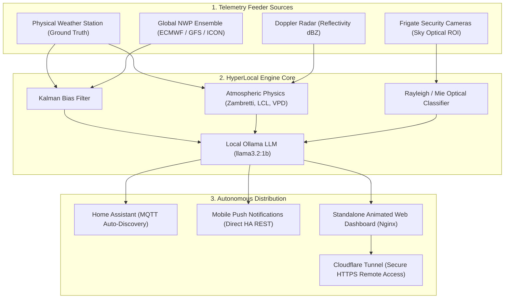

# 🌤️ HyperLocal Weather Meteorological Engine

[](https://opensource.org/licenses/MIT)
[](https://www.python.org/)
[](https://www.home-assistant.io/)
[](https://ollama.com/)
[](https://www.docker.com/)

An autonomous, microclimate-aware meteorological engine that fuses **ground-truth weather stations** (Ecowitt, Davis, Ambient), **global numerical weather predictions** (ECMWF, GFS, ICON via Open-Meteo), **Doppler radar nowcasting**, **optical camera sky segmentation** (Frigate NVR), and **local AI synthesis** (Ollama) into actionable everyday intelligence.

---

## ✨ Features

* **🔬 Kalman Filter Bias Correction:** Automatically calibrates global 9km NWP supercomputer forecasts against your garden's exact physical thermometer and barometer history, eliminating local microclimate drift.
* **⚡ Atmospheric Physics & Barometric Tendency:**
  * **Zambretti Forecaster:** 140-year-old nautical barometer rule computing 26 weather regimes based on 3-hour pressure rate of change ($\Delta P/3h$).
  * **Virga Suppression (VPD):** Evaluates Saturation Vapor Pressure Deficit to prevent false rain alarms when radar echoes evaporate in dry surface air.
  * **Lifting Condensation Level (LCL):** Dynamically calculates exact cloud base height above roof level.
* **👁️ Optical Sky Vision (Computer Vision Nowcasting):**
  * Clips sky regions of interest from outdoor security cameras (Frigate NVR or RTSP/HTTP snapshots).
  * Computes Rayleigh vs. Mie scattering ratios ($R/B$) to detect cloud water droplets and determine WMO oktas ($0/8$ clear to $8/8$ overcast).
  * Contrast standard deviation analysis ($\sigma_Y$) flags ground-level radiation fog and morning haze.
* **🤖 Local AI Weather Concierge (Ollama):**
  * Synthesizes live physics telemetry into engaging, plain-English advice.
  * Delivers punchy 2-word badges: Daily Outfit, Umbrella Advisory, Car Wash Index, and Smart Home Living tips.
* **🚨 Autonomous Push Alerts:**
  * Scheduled weekday morning concierge briefing (e.g., 8:00 AM) with 8–10 hour outlook and day peak temperature.
  * Event-driven alerts for imminent radar rain, severe squalls/pressure drops, and frost/freeze warnings.
* **🌐 Animated Synaptic Web Experience:**
  * Interactive "FusionSolar-style" moving current diagram showing data flowing into the central Kalman reactor.
  * Doppler radar sweep canvas with virga evaporation simulation.
  * Live camera sky vision overlays and technical explainer info modals.

---

## 🏗️ Architecture



---

## 🚀 Quickstart

### Option A: Docker Compose (Recommended)

1. **Clone the repository:**
   ```bash
   git clone https://github.com/cybuletz/hyperlocal-weather.git
   cd hyperlocal-weather
   ```

2. **Configure your environment:**
   ```bash
   cp .env.example .env
   cp config.example.json config.json
   ```
   Edit `.env` and `config.json` with your Home Assistant token, MQTT broker address, and coordinates.

3. **Start the engine:**
   ```bash
   docker compose up -d
   ```

4. **Access the Web Dashboard:**
   Open [http://localhost:8080](http://localhost:8080) in your browser.

---

### Option B: Proxmox LXC / Linux Host

1. **Install dependencies (Alpine or Debian/Ubuntu):**
   ```bash
   # Alpine Linux
   apk add python3 py3-pillow py3-paho-mqtt nginx
   
   # Debian / Ubuntu
   apt-get install -y python3 python3-pil python3-paho-mqtt nginx
   ```

2. **Clone and setup:**
   ```bash
   git clone https://github.com/cybuletz/hyperlocal-weather.git /opt/hyperlocal-weather
   cd /opt/hyperlocal-weather
   cp .env.example .env
   chmod 600 .env
   cp config.example.json config.json
   ```

3. **Run as an OpenRC or systemd daemon:**
   * OpenRC service script provided in `openrc/hyperlocal-weatherd`.
   * Nginx web host configuration provided in `nginx/weather.conf`.

---

## ⚙️ Configuration Reference

### `.env` (Environment Secrets)

| Variable | Description | Example |
| :--- | :--- | :--- |
| `HA_URL` | Home Assistant base URL | `http://homeassistant.local:8123` |
| `HA_TOKEN` | Long-Lived Access Token for Home Assistant | `eyJhbGci...` |
| `HA_NOTIFY_SERVICE` | Target notify service for alerts | `notify.notify` or `notify.mobile_app_phone` |
| `MQTT_HOST` | Mosquitto MQTT broker hostname/IP | `homeassistant.local` |
| `MQTT_PORT` | Mosquitto MQTT broker port | `1883` |
| `MQTT_USERNAME` | MQTT user with publish permissions | `homeassistant` |
| `MQTT_PASSWORD` | MQTT user password | `secret_password` |
| `OLLAMA_URL` | Local Ollama API endpoint | `http://localhost:11434` |
| `OLLAMA_MODEL` | Ollama model tag for synthesis | `llama3.2:1b` |
| `FRIGATE_URL` | Frigate NVR HTTP API endpoint | `http://frigate.local:5000` |
| `FRIGATE_CAMERAS` | Comma-separated list of outdoor sky cameras | `sky_cam_front,horizon_cam_yard` |
| `WEB_PORT` | HTTP port for the standalone dashboard | `8080` |

### `config.json` (Station & Sensor Mappings)

* **`location`**: Latitude, longitude, elevation (m), and timezone. Used for solar clear-sky calculations ($K_t$) and NWP ensemble coordinates.
* **`entities`**: Maps your Home Assistant weather station sensor IDs (`relative_pressure`, `outdoor_temperature`, `outdoor_humidity`, `dewpoint`, `solar_radiation`, `wind_speed`, `rain_rate`, etc.).

---

## 📡 Home Assistant Auto-Discovery Entities

All entities are automatically registered under MQTT discovery with no manual YAML configuration:

* `sensor.hyperlocal_weather` (Complete Native Weather Entity with hourly forecast)
* `sensor.daily_outfit_outdoor_advisory` (Concierge Outfit Badge)
* `sensor.umbrella_advisory` (Concierge Umbrella Needed Badge)
* `sensor.car_wash_advisory` (Concierge Car Wash Index)
* `sensor.frigate_sky_optical_cloud_cover` (Optical percentage & WMO oktas)
* `sensor.frigate_sky_visual_condition` (Visual sky condition)
* `binary_sensor.frigate_optical_fog_haze_alert` (Camera contrast fog detector)
* `sensor.hyperlocal_rain_onset_eta` (Doppler radar nowcast ETA badge)
* `sensor.hyperlocal_zambretti_barometer_trend` (Zambretti regime output)
* `binary_sensor.hyperlocal_storm_squall_alert` (Barometric plunge / wind alert)
* `binary_sensor.hyperlocal_radiation_fog_alert` (Dew point inversion alert)

---

## 🔒 Security & Privacy by Design

* **Zero Cloud Lock-in:** 100% of telemetry calculations and AI synthesis execute locally on your hardware.
* **Strict Secret Isolation:** `.gitignore` blocks `.env`, `config.json`, `.htpasswd`, and database state files. All code references environment variables with sanitized fallbacks.
* **Built-in HTTP Basic Authentication:** Protects the web UI and `/api/telemetry.json` behind a secure password prompt. Generate credentials using:
  ```bash
  apk add --no-cache apache2-utils  # or: apt-get install -y apache2-utils
  htpasswd -bc /etc/nginx/.htpasswd admin <your-secure-password>
  ```
* **Multi-Layer Anti-Indexing:** Designed for private sharing via Cloudflare Tunnels without being indexed by Google, Bing, or web bots:
  - Meta tags: `<meta name="robots" content="noindex, nofollow, noarchive, nosnippet">`
  - Nginx response headers: `add_header X-Robots-Tag "noindex, nofollow, noarchive, nosnippet" always;`
  - Standard `robots.txt` denying all crawlers (`Disallow: /`).
  - Web root password protection returning `401 Unauthorized` to any unauthorized automated crawler.

---

## 📄 License

This project is licensed under the [MIT License](LICENSE) - see the LICENSE file for details.
